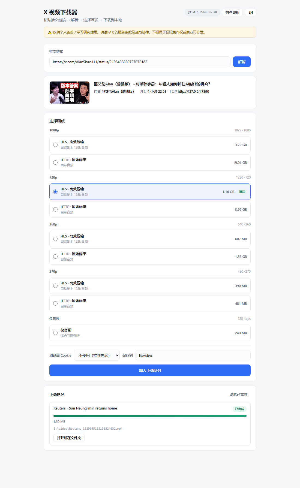

# X Video Downloader

<p align="center">
  
</p>

<p align="center">
  <a href="LICENSE"></a>
  
  
  
</p>

<p align="center">
  <b>中文</b> · <a href="#english">English</a>
</p>

---

> ## ⚠️ 免责声明
>
> 本工具仅供**个人备份与学习研究**使用。
>
> - 下载内容的版权归原作者及平台所有
> - 请遵守 X（Twitter）的服务条款与您所在地区的法律法规
> - **严禁**将下载内容用于侵犯著作权、商业再分发或任何违法用途
>
> 使用者需自行承担因使用本工具产生的一切后果。作者不对任何滥用行为负责。
> **如果你不确定某个用途是否合规，那就不要做。**

---

## 这是什么

一个跑在**你自己电脑上**的网页工具：粘贴 X（Twitter）的推文链接 → 解析出所有可用画质 → 选一个 → 下载到本地。

不需要登录 X，不需要申请 API，不向任何第三方服务器发送数据。

```
粘贴链接  →  解析画质  →  选一档  →  排队下载  →  打开文件夹
```

## 特点

| | |
|---|---|
| 🎛 **可视化选画质** | 按分辨率自动分组，标注实际体积，并给出推荐档 |
| 🔊 **自动合并音视频** | X 的 HLS 流是纯视频轨，工具会自动补上音轨并合并 |
| ⚡ **并发分片下载** | 默认 4 路并发。实测比单线程快约 60 倍（16 KB/s → 1.1 MB/s） |
| 🍪 **浏览器 Cookie** | 受保护 / 年龄限制的推文也能下载 |
| 📋 **下载队列** | 一次加多个自动排队，随时可取消 |
| 🔄 **一键更新 yt-dlp** | X 的接口改动频繁，保持最新才不会失效 |
| 🌏 **中英双语界面** | 右上角一键切换 |
| 🔒 **本地接口有防护** | 随机 token + Origin 校验，防止其它网页偷偷调用你的下载器 |
| 📦 **几乎零依赖** | 后端只用 Python 标准库；唯一第三方依赖是 yt-dlp |

---

## 快速开始

**前置要求：** Python 3.9+ 与 ffmpeg

### Windows

双击 `run.bat` 即可。脚本会自动找到 Python 并在缺少 yt-dlp 时安装它。

### macOS / Linux

```bash
chmod +x run.sh
./run.sh
```

也可以直接用 Python 启动：

```bash
pip install -U yt-dlp
python app.py
```

首次运行会在当前目录生成 `config.json`，并自动打开浏览器。

### 安装 ffmpeg

| 平台 | 命令 |
|---|---|
| Windows | `winget install Gyan.FFmpeg` 或 `scoop install ffmpeg` |
| macOS | `brew install ffmpeg` |
| Debian / Ubuntu | `sudo apt install ffmpeg` |

> ffmpeg 只在**合并音视频**时用到。没有它时视频仍能下载，但「纯视频」格式会没有声音 —— 启动日志里会明确提示。

---

## 使用方法

1. **粘贴推文链接**，点「解析」
   （支持 `x.com/...` 和 `twitter.com/...` 两种域名）
2. **选一档画质** —— 带「推荐」标记的是默认建议
3. **需要时选 Cookie** —— 受保护或年龄限制的推文必须选
4. **确认保存目录**（会自动记住，下次不用再填）
5. 点「加入下载队列」

任务会**依次**执行，完成后可以点「打开所在文件夹」直接定位到文件。

---

## 关于画质选项（值得读一下）

X 为同一个视频提供**两套编码**，体积差别很大：

| 类型 | 说明 | 相对体积 |
|---|---|---|
| **HLS** | 自适应码率切片流，压缩效率高 | 小 |
| **HTTP** | 渐进式 MP4，接近原始码率 | 约 **4 倍** |

举例：同一个 720p 画面，HLS 版 1.16 GB，HTTP 版 3.99 GB。

**建议：**

- **访谈、影视、口播类** → 选 **HLS**，画质基本看不出差别，体积省一大半
- **画面里有大量文字、图表，或需要逐帧细看** → 再选 **HTTP**

**推荐档是怎么算的：** 在最高分辨率里，挑总体积不超过 1.5 GB 的那一档。所以短视频会自动推荐 1080p，而 4 小时的长视频会自动降到 720p —— 不用你每次手动算。

---

## 命令行参数

```
python app.py [选项]

  --port N          监听端口（默认 8765，被占用时自动顺延）
  --outdir PATH     下载目录（默认 ~/Downloads）
  --proxy URL       HTTP 代理，例如 http://127.0.0.1:7890（默认自动探测）
  --cookies NAME    复用浏览器 Cookie：chrome / edge / firefox / brave / safari
  --fragments N     并发分片数，1–16（默认 4）
  --no-browser      启动后不自动打开浏览器
  --version         显示版本
```

也支持环境变量：`XDL_OUTDIR`、`XDL_PROXY`、`XDL_PORT`、`XDL_COOKIES`、`XDL_FRAGMENTS`、`XDL_OPEN_BROWSER`。

**优先级：** 内置默认值 → `config.json` → 环境变量 → 命令行参数

### 手动用 yt-dlp 做同样的事

这个工具内部就是调用 yt-dlp。如果你想自己敲命令：

```bash
# 1) 看有哪些格式
yt-dlp --proxy http://127.0.0.1:7890 -F "https://x.com/用户/status/1234567890"

# 2) 按格式 ID 下载
yt-dlp --proxy http://127.0.0.1:7890 \
  --concurrent-fragments 4 --fragment-retries 25 --retries 25 \
  -f "hls-506+hls-audio-128000-Audio" \
  --merge-output-format mp4 \
  -o "下载目录/%(uploader_id)s_%(id)s.%(ext)s" \
  "https://x.com/用户/status/1234567890"
```

> ⚠️ **最容易踩的坑**：X 上的 `hls-*` 格式是**纯视频**，必须用 `+` 拼上音频 ID，否则下出来没声音。`http-*` 格式自带音频，直接写 ID 即可。

---

## 配置文件

`config.json`（首次运行自动生成）：

```json
{
  "outdir": "",
  "proxy": "",
  "port": 8765,
  "cookies_browser": "",
  "concurrent_fragments": 4,
  "open_browser": true
}
```

| 字段 | 说明 |
|---|---|
| `outdir` | 留空表示使用 `~/Downloads` |
| `proxy` | 留空表示自动探测常见本地代理端口 |
| `cookies_browser` | 留空表示默认不带 Cookie |

---

## 常见问题

**Q：解析失败 / 一直转圈？**
X 在部分网络环境下无法直连，需要代理。启动日志里会打印探测到的代理；没探测到就用 `--proxy` 手动指定。

**Q：下出来的视频没有声音？**
说明你选的格式是纯视频轨但音频没合并成功。最常见原因是**缺 ffmpeg**，看启动日志里的 `ffmpeg` 那一行。装上 ffmpeg 后重新下载即可。

**Q：提示 "No video could be found"？**
这条推文里没有视频（纯文字或图片）。引用推文、转推有时也会这样。

**Q：受保护 / 年龄限制的推文下不了？**
在「浏览器 Cookie」里选你已登录 X 的那个浏览器。注意下载期间该浏览器最好不要完全退出。

**Q：下载中断了怎么办？**
把同样的任务再加一次就行，会**断点续传**。yt-dlp 保留着已下载的分片，不会从头开始。
⚠️ 不要手动删除下载目录里的 `.part` 和 `Frag*` 文件。

**Q：速度不稳定？**
取决于你的代理带宽。可以用 `--fragments` 调整并发数（默认 4，最大 16）。

**Q：端口被占用？**
程序会自动往后找可用端口，实际地址以启动窗口输出为准。也可以 `--port` 指定。

**Q：为什么本地服务还需要 token？**
防止其它网页偷偷向 `127.0.0.1` 发请求、让你的电脑在不知情的情况下开始下载文件。token 每次启动随机生成，只注入到本页面里。

**Q：支持哪些平台？**
Windows 已充分测试。macOS / Linux 的代码路径已实现（路径、打开文件夹、启动脚本），但**尚未在真机验证** —— 遇到问题欢迎提 Issue。

---

## 项目结构

```
x-video-downloader/
├── app.py              # 入口：HTTP 服务与路由
├── core/
│   ├── config.py       # 配置加载 + 代理探测
│   ├── ytdlp.py        # yt-dlp 定位 / 版本 / 更新 / 解析 / 命令构造
│   ├── tasks.py        # 下载队列与取消
│   └── util.py         # 跨平台小工具
├── web/
│   ├── index.html
│   ├── style.css
│   └── app.js          # 前端逻辑 + 中英双语字典
├── run.bat / run.sh
├── config.example.json
└── requirements.txt
```

设计上刻意保持**无框架、无构建步骤** —— 克隆下来就能跑，也方便你按自己的需求改。

---

## 贡献

欢迎 Issue 和 PR。提交前请确认：

- 不引入新的第三方依赖（除非有充分理由）
- 改动后在 Windows 上实际跑一遍

---

## License

[MIT](LICENSE) © 2026 1989Mei

---

<a id="english"></a>

# X Video Downloader (English)

<p align="center">
  
</p>

> ## ⚠️ Disclaimer
>
> This tool is intended for **personal backup and research use only**.
>
> - Downloaded content remains the property of its original authors and platform
> - You must comply with X's Terms of Service and the laws of your jurisdiction
> - **Do not** use it to infringe copyright, redistribute commercially, or for any unlawful purpose
>
> You are solely responsible for how you use this software. The author accepts no
> liability for misuse. **If you are unsure whether a use case is legitimate, don't do it.**

## What it is

A small local web app that runs on **your own machine**. Paste an X (Twitter) post
URL, see every available quality, pick one, and download it.

No X login. No API keys. Nothing is sent to a third-party server.

## Features

| | |
|---|---|
| 🎛 **Visual quality picker** | Grouped by resolution, with real file sizes and a suggested tier |
| 🔊 **Automatic A/V merge** | X's HLS streams are video-only; audio is added and merged for you |
| ⚡ **Concurrent fragments** | 4 parallel fragments by default — measured ~60× faster than a single thread |
| 🍪 **Browser cookies** | Works with protected and age-restricted posts |
| 📋 **Download queue** | Queue several jobs; cancel any of them at any time |
| 🔄 **One-click yt-dlp update** | X changes often — stay current so extraction keeps working |
| 🌏 **Bilingual UI** | Chinese / English, one click to switch |
| 🔒 **Guard rails on the local API** | Random token + Origin check so other web pages can't drive it |
| 📦 **Almost zero dependencies** | Backend is pure standard library; the only dependency is yt-dlp |

## Quick start

**Requirements:** Python 3.9+ and ffmpeg

```bash
# Windows
run.bat

# macOS / Linux
chmod +x run.sh && ./run.sh

# or directly
pip install -U yt-dlp
python app.py
```

A `config.json` is created on first run, and your browser opens automatically.

ffmpeg install: `winget install Gyan.FFmpeg` (Windows) · `brew install ffmpeg` (macOS) ·
`sudo apt install ffmpeg` (Debian/Ubuntu).

## Usage

1. Paste a post URL and hit **Parse**
2. Pick a quality (the one marked **Best** is the suggested default)
3. Choose a **browser cookie** source if the post is protected
4. Confirm the output folder (it is remembered)
5. Hit **Add to queue**

Jobs run one at a time. When a job finishes you can jump straight to the file.

## A note on quality options

X serves each video in two flavours, and the size difference is large:

| Type | Description | Relative size |
|---|---|---|
| **HLS** | Adaptive-bitrate segments, efficient | small |
| **HTTP** | Progressive MP4, near-original bitrate | about **4×** |

Same 720p picture: HLS ≈ 1.16 GB, HTTP ≈ 3.99 GB.

**Rule of thumb** — for interviews, talk shows and film, **HLS is indistinguishable and
saves more than half the space**. Reach for **HTTP** only when the frame contains a lot
of text or you need to inspect detail frame by frame.

**How "Best" is chosen:** the highest resolution whose estimated total size stays under
1.5 GB, so short clips suggest 1080p while a 4-hour stream drops to 720p automatically.

## CLI options

```
python app.py [options]

  --port N          listen port (default 8765, auto-increments if busy)
  --outdir PATH     download directory (default ~/Downloads)
  --proxy URL       HTTP proxy, e.g. http://127.0.0.1:7890 (default: auto-detect)
  --cookies NAME    reuse browser cookies: chrome / edge / firefox / brave / safari
  --fragments N     concurrent fragments, 1–16 (default 4)
  --no-browser      do not open the browser on start
  --version         print version
```

Environment variables are also supported: `XDL_OUTDIR`, `XDL_PROXY`, `XDL_PORT`,
`XDL_COOKIES`, `XDL_FRAGMENTS`, `XDL_OPEN_BROWSER`.

Priority: defaults → `config.json` → environment → CLI flags.

## Doing it manually with yt-dlp

```bash
# list formats
yt-dlp --proxy http://127.0.0.1:7890 -F "https://x.com/user/status/1234567890"

# download a specific one
yt-dlp --proxy http://127.0.0.1:7890 \
  --concurrent-fragments 4 --fragment-retries 25 --retries 25 \
  -f "hls-506+hls-audio-128000-Audio" \
  --merge-output-format mp4 \
  -o "out/%(uploader_id)s_%(id)s.%(ext)s" \
  "https://x.com/user/status/1234567890"
```

> ⚠️ **The classic gotcha:** on X, `hls-*` formats are **video-only**. You must append an
> audio format with `+`, otherwise the result has no sound. `http-*` formats already
> include audio.

## FAQ

**Parse fails or hangs** — X needs a proxy on some networks. The startup log prints the
detected proxy; pass `--proxy` if detection misses.

**The video has no sound** — You picked a video-only format and the audio merge failed,
usually because **ffmpeg is missing**. Check the `ffmpeg` line in the startup log.

**"No video could be found"** — This post has no video (text or image only).

**Protected / age-restricted posts fail** — Pick the browser you are logged into under
"Browser cookies".

**A download was interrupted** — Just queue the same job again; it **resumes** from the
existing fragments. Do not delete the `.part` and `Frag*` files.

**Why does a local server need a token?** — So that other web pages cannot silently POST
to `127.0.0.1` and make your machine download files. The token is random per run and is
only injected into the served page.

**Platform support** — Windows is well tested. macOS / Linux code paths exist but are
**not verified on real hardware** yet — please open an issue if something breaks.

## License

[MIT](LICENSE) © 2026 1989Mei
